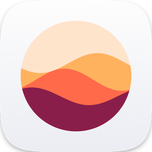
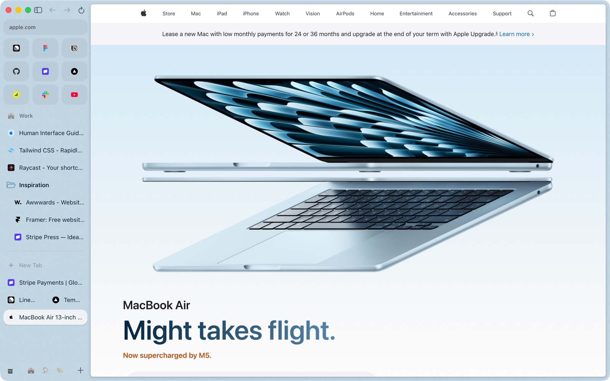
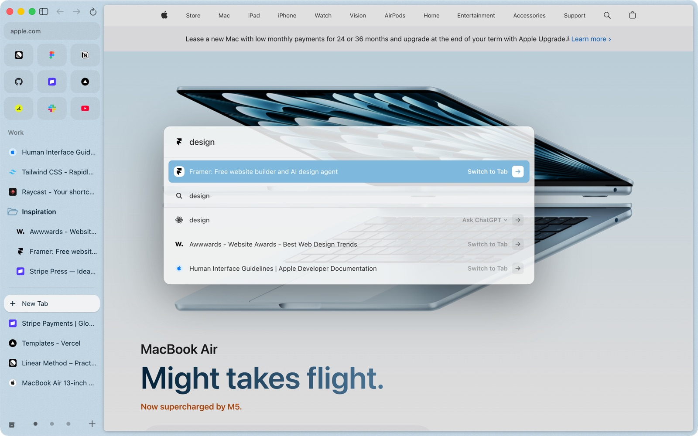
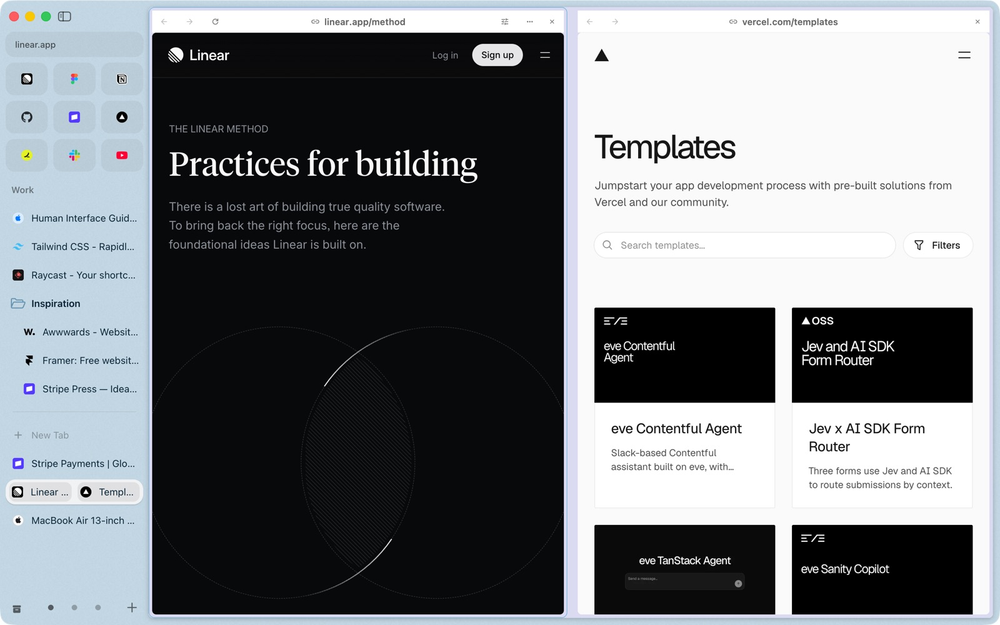
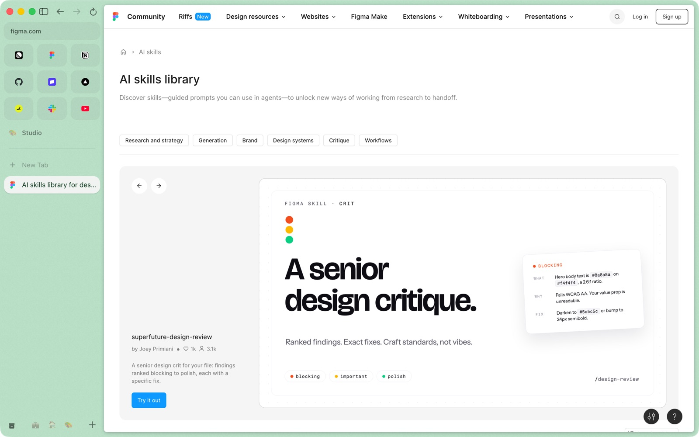
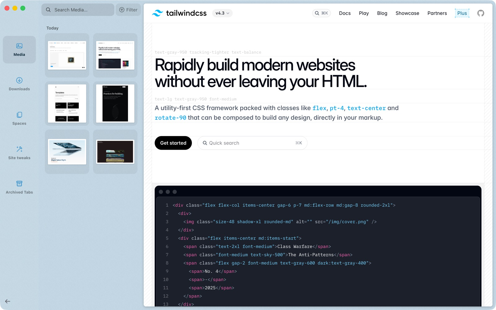

# Rio

**The open-source Arc alternative for Mac.** 
Arc stops working on December 22, 2026. Rio imports your Arc spaces, pinned tabs, folders and favorites in one step, runs Chromium 158, and its Speedometer 3.1 index is above Arc's published one (97.8 vs 91.0).

<picture>
  <source media="(prefers-color-scheme: dark)" srcset=".github/assets/hero-dark.jpg">
  
</picture>

## What is Rio?

Rio is an open-source web browser for Mac that keeps your tabs in a sidebar and gives each kind of work its own space, the way Arc did. It is built on Chromium 158, so your Chrome extensions work, including current MV3 extensions from the Chrome Web Store. If you used Arc, Rio brings your spaces, pinned tabs, folders and favorites over in one step.

This repository holds the downloads and the update feed for Rio. The app updates itself from here through Sparkle.

## Download

[**Download Rio.dmg**](https://github.com/Levivajan/rio-releases/releases/latest/download/Rio.dmg), open it and drag Rio to Applications. All versions are on the [Releases](https://github.com/Levivajan/rio-releases/releases) page.

### First launch

This build is signed with a self-signed certificate and is not notarized yet, so macOS asks before it opens Rio the first time:

1. Open Rio from Applications and close the warning.
2. Go to System Settings, Privacy & Security, and scroll to Security.
3. Click **Open Anyway** next to Rio, then confirm.

On macOS 13 and 14 you can instead right-click Rio in Applications, choose **Open**, then confirm.

You do this once. Later updates come through Sparkle inside the app.

### Requirements

- A Mac with Apple silicon. Intel Macs are not supported.
- macOS 13 (Ventura) or newer.

## What you get

- **Spaces** with their own pinned tabs, folders and theme color.
- **Pinned tabs that remember their page**, and a grid of favorites.
- **A command bar** (Cmd+T) for tabs, URLs and questions.
- **The Library** for downloads, media and screenshots.
- **Split view and Peek** for two pages at once or a quick look at a link.
- **Import from Arc** in one step: spaces, pinned tabs, folders and favorites.
- **Chrome extensions**, including current MV3 ones from the Chrome Web Store.

<table>
  <tr>
    <td width="50%"></td>
    <td width="50%"></td>
  </tr>
  <tr>
    <td width="50%"></td>
    <td width="50%"></td>
  </tr>
</table>

## Speed and memory

Speedometer 3.1 as an index with Chrome = 100: Rio scored 97.8 in our run against Chrome 156.0.8078.81 on the same Mac (2026-11-09). BrowseRating ([browserating.com](https://browserating.com), updated 2026-10-03) publishes Edge 97.1, Safari 95.0, Comet 95.0, Brave 94.3, Arc 91.0, Dia 89.3, Firefox 82.0 and Atlas 67.4. That puts Rio about 7% above Arc's published index (97.8 against 91.0) and 2.2 points below Chrome. Each index is a score against Chrome on the machine that ran it; BrowseRating's Mac is not ours and it does not publish its hardware, and another source puts Safari at 98.1, so we make no claim against Safari.

Memory with the same 6 sites open, 2026-11-09, read as resident memory of every process 20 seconds after the sixth site opened: Rio used 3,880 MB across 23 processes and Chrome used 6,465 MB across 41, which is 40% less (2,585 MB lower). This is one run, and a larger test across 11 browsers will replace it.

## Open source

The source code is open under GPL-3.0, with commercial licenses for closed-source use. Source code: github.com/Levivajan/rio (coming soon). Commercial licenses: rio@riobrowser.app.

## Report a problem

The source repository will take bug reports and feature requests when it opens. Until then, open an issue here with the Rio version from the About Rio window, your macOS version and your Mac model.

Made by [Levon Adamyan](https://www.linkedin.com/in/levon-adamyan), Founder of Rio and [Clu](https://clugtm.com).

Arc is a trademark of The Browser Company of New York. Rio is not affiliated with or endorsed by The Browser Company, Google or Apple. Websites shown in screenshots belong to their owners.
